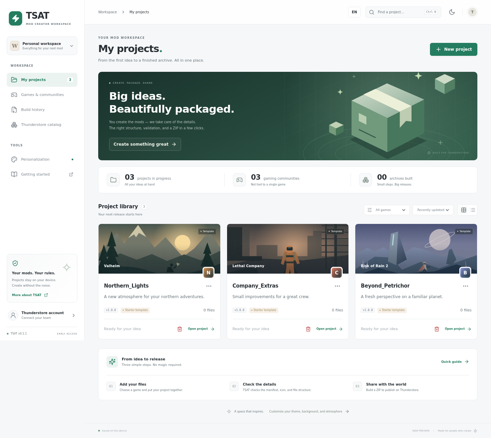

<p align="center"></p>

<p align="center">
  <strong>Your mod workshop. From an idea to a neatly packaged release.</strong><br />
  A local workspace for Thunderstore authors — without the busywork.
</p>

<p align="center">
  <strong>English</strong> · <a href="docs/README.ru.md">Русский</a><br />
  <a href="#features">Features</a> · <a href="#quick-start">Quick start</a> ·
  <a href="#windows-builds">Windows</a> · <a href="docs/SECURITY.md">Security</a> ·
  <a href="https://github.com/ItzHanchik/ThunderStoreArchiveTool-TSAT-/issues">Feedback</a>
</p>

> **Early access · 0.1.1 bugfix update.** Not an official Thunderstore client. English is the default interface and documentation language; Russian remains available. Existing language preferences and project content are preserved. Direct API publishing is experimental; mocked contract tests are not proof of a successful live publication. You can always export a ZIP and publish on the website.

## Features

| Create and release | Make it yours |
| --- | --- |
| Project library, search, game filters, duplication | Light and dark themes |
| Visible project deletion with confirmation | Six accent presets or a custom color |
| Manifest v1, files, dependencies, local validation | Custom PNG / JPG / WebP wallpaper |
| README / CHANGELOG question-based assistant | Snow, rain, or a calm background |
| Safe Markdown editing and preview | Comfortable and compact layouts |
| Folder imports preserving nested paths | English-first UI with a Russian option |
| Async ZIP export, local build history | Keyboard navigation and `Ctrl K` search |
| IndexedDB autosave for projects and settings | Reduced-motion support |
| Experimental desktop Thunderstore publication | Non-destructive icon studio |

<p align="center"></p>

### Many games. One workflow.

Valheim, Lethal Company, Risk of Rain 2, Content Warning, BONEWORKS, BONELAB, ROUNDS, R.E.P.O., and more. For another game, enter the community identifier from `thunderstore.io/c/<community>/`.

TSAT supports the common **manifest v1** format, not a universal mod-loader layout. Choose the correct loader, files, folder structure, and dependencies for your game. Built-in game illustrations are original artwork, not official covers. The first three projects are **starter templates without game DLLs**, not installable mods.

## Quick start

Requires **Node.js 22.12+** (current Node 22 recommended) and npm.

```bash
npm ci
npm run dev
```

Open Vite's URL. The browser version edits projects and downloads ZIP archives. It **does not accept API tokens or publish directly**: use the official website for the final upload. Direct publishing is available only in the Electron desktop application.

```bash
npm test          # Packaging, publishing/security, documents, storage, locale tests
npm run build     # TypeScript check + production web bundle
npm run preview   # Production web preview
npm run desktop   # Build UI and launch Electron
npx playwright install chromium
npm run test:ui   # Browser smoke (build first); starts its own preview
```

If Electron binaries cannot be downloaded in your development environment:

```bash
# Linux / macOS: web-only development
ELECTRON_SKIP_BINARY_DOWNLOAD=1 npm ci
```

### Your first package

1. Choose **New project**, enter a package name, and select a game/community.
2. In **Manifest**, fill in the description, version, website, and team namespace.
3. Choose an existing 256 × 256 PNG, or open **Customize icon**.
4. Add DLLs/configuration/resources in **Files**. Use **Choose folder** to preserve subfolders; folder drag-and-drop is deliberately not supported.
5. In **Description**, edit Markdown directly or choose **Answer a few questions**.
6. Add versioned dependencies as `Author-Package-1.0.0`.
7. Review **Validation**, then **Build ZIP**. Local validation does not guarantee server acceptance.
8. Publish through the website, or connect a service-account token in the desktop app.

Delete projects using the trash button on a library card or **Delete project** in the editor. Deletion requires confirmation, removes only the local project and its files, and leaves exported ZIPs, build history, and published packages untouched. Export a backup first; deletion cannot be undone.

## README & CHANGELOG assistant

**Description → Answer a few questions** opens a four-step local assistant:

- **About the mod:** summary, features, requirements.
- **Installation & support:** exact installation steps, configuration, tested compatibility, support, license.
- **This release:** added, changed, fixed, known issues.
- **Review documents:** inspect rendered Markdown and choose README, CHANGELOG, or both.

Headings are English. Answers stay in the language you type; TSAT does not translate or invent facts. Empty sections are omitted. At least a summary is required for README; at least one release note is required for CHANGELOG. Applying changes requires explicit confirmation. Only the current version's changelog entry is replaced; older versions are retained. **Restore previous documents** undoes the last replacement while the editor stays open. Closing the assistant without applying changes does not alter your documents; unfinished answers are not saved.

## Icon studio

**Manifest → Customize icon** works with both generated and imported icons:

- Import **PNG, JPG, or WebP**, up to **10 MB / 40 megapixels**. Sources are resized to a maximum of 1024 pixels per side before saving.
- Adjust image scale, horizontal/vertical position, rotation, opacity, and dark overlay.
- Choose solid or gradient backgrounds, colors, angle, and palette presets.
- Add text, choose a font family, size, position, color, bold style, and shadow.
- Customize border thickness, inset, color, and corner radius.
- Preview at full size and a small catalog-like size. Apply to save a valid **256 × 256 PNG**.

The source image and design settings stay in the local project for later editing. ZIPs contain only the flattened `icon.png`, not TSAT's editable design. **Restore previous icon** restores the previous icon/design while the editor stays open. Cancel leaves the current icon unchanged.

## Connect to Thunderstore

**No invented OAuth flow, cookie interception, or password entry in TSAT.**

1. Open Thunderstore from the account panel. Sign in in your system browser.
2. On the website, go to **Settings → Teams → your team → Service accounts**.
3. Create a separate service account for TSAT and copy its token.
4. Save it in the desktop app and enter your team's namespace in the project.
5. Publishing requires confirmation in both the interface and a native dialog.

Tokens are encrypted using Electron `safeStorage` (**Windows DPAPI**), never returned to the renderer, and never included in IndexedDB or ZIP exports. Storage is blocked if secure OS encryption is unavailable. “Saved” does not mean “permissions verified.” The online catalog can check authentication and list teams; the server makes the final authorization decision. Deleting a saved token does not revoke it on the website.

Publishing follows `initiate-upload → multipart PUT → finish-upload → submission/submit`. The bearer token goes only to Thunderstore's API, never to storage hosts. Uploads require HTTPS, an allowed storage hostname, non-overlapping parts covering the entire ZIP, and no redirects. The 0.1.1 update adds Backblaze B2 S3 endpoints to the existing AWS S3 / Cloudflare R2 / Thunderstore allowlist. Unknown hosts are still blocked; the error reports only the hostname, not signed URL credentials.

**If the connection fails during final submission, check the package page before retrying**: the version might already have been accepted. Real-world publication still needs verification with a valid team and an unpublished package version. No live mod is published by the test suite.

Upstream contracts: [official CLI](https://github.com/thunderstore-io/thunderstore-cli/blob/master/ThunderstoreCLI/Commands/PublishCommand.cs), [publish models](https://github.com/thunderstore-io/thunderstore-cli/blob/master/ThunderstoreCLI/Models/PublishModels.cs), [multipart plan](https://github.com/thunderstore-io/Thunderstore/blob/master/django/thunderstore/usermedia/s3_upload.py), [manifest rules](https://github.com/thunderstore-io/Thunderstore/blob/master/django/thunderstore/repository/package_manifest.py).

## Windows builds

Target: **Windows 10/11 x64**.

```powershell
npm ci
npm run dist:win -- --publish never
```

Output in `release/`:

- `TSAT-0.1.1-x64-nsis.exe` — installer with directory selection and shortcuts.
- `TSAT-0.1.1-x64-portable.exe` — no installation required.

The **Windows installer and portable** workflow can be run manually and runs on version tags and Arena working-branch pushes. It builds both executables, launches the packaged application, checks imports/ZIP export, DPAPI, persistence and localization, exercises the document/icon/deletion workflows, and produces SHA-256 checksums. Successful builds upload a `TSAT-Windows-x64` artifact. Binaries can be attached only to an explicitly prepared draft release targeting the exact build SHA. Publishing that release remains an explicit action.

**Binaries are not code-signed.** Windows SmartScreen may warn about an unknown publisher. Automated smoke tests do not replace manual install/uninstall and live-publication testing. There is no automatic updater.

Installed app data lives in `%APPDATA%/TSAT`. Portable builds use `TSAT-data` next to the EXE, which must be writable. Encrypted tokens are bound to the Windows user/device; reconnect after moving to another PC. Back up your projects before upgrading or deleting app data.

## Data and limits

- All projects, files, designs, and preferences are local. No TSAT server, telemetry, or cloud sync.
- Back up with ZIP exports. To restore, extract a ZIP and import its folder into a new project; set the team and game separately.
- Clearing application/browser storage deletes the library. IndexedDB is not a backup service.
- Local limit: **200 MB / 2000 files per project**. Archives are assembled in memory; multi-gigabyte mods are not supported.
- Import ignores `.git`, `.env*`, `node_modules`, `.DS_Store`, `Thumbs.db`, `.pdb`, `.zip`, and `.exe`. This is not a complete secret scanner: inspect your files yourself.
- Root manifest/README/changelog/icon files are imported into the corresponding editor fields. Duplicate asset paths are replaced case-insensitively.
- Additional manifest fields such as `installers` are not yet supported: imports are rejected rather than silently discarding them.
- Dependency existence, version uniqueness, categories, team permissions, and moderation are server-side checks.
- TSAT manages **authoring projects**, not installed game mods. The online catalog creates metadata-only local drafts; it does not download original DLLs, icons, or README files. Two-way synchronization is not implemented.
- Markdown HTML is not executed; external preview images are blocked.

## Project layout

```text
src/App.tsx              Library, navigation, appearance, account
src/Editor.tsx           Metadata, assets, documents, publishing
src/DocumentWizard.tsx   Question-based document assistant
src/IconStudio.tsx       Image, text, background, border controls
src/lib/documents.ts     Deterministic Markdown / release-note generation
src/lib/icon.ts          Raster import and 256px canvas rendering
src/lib/package.ts       Package validation and ZIP creation
src/lib/storage.ts       IndexedDB and export
shared/                  English UI/native-dialog dictionary
electron/                Sandboxed window, limited IPC, encrypted tokens, API
scripts/                 Packaged Windows and browser smoke checks
tests/                   Automated unit / mocked API tests
.github/workflows/       Quality checks and Windows distribution
```

## Contributing

Report bugs and ideas in [Issues](https://github.com/ItzHanchik/ThunderStoreArchiveTool-TSAT-/issues), including TSAT version, OS, and reproduction steps. **Never attach tokens, cookies, or private files.** Before a PR, run `npm test && npm run build`.

[MIT](LICENSE) · Made by **ItzHanchik** · Not affiliated with Thunderstore or game developers.
