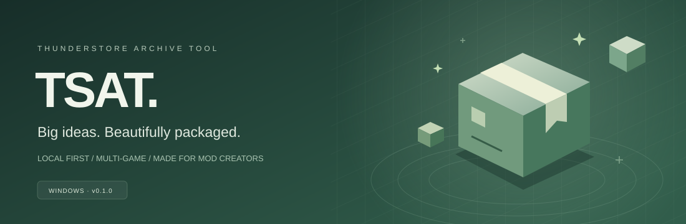
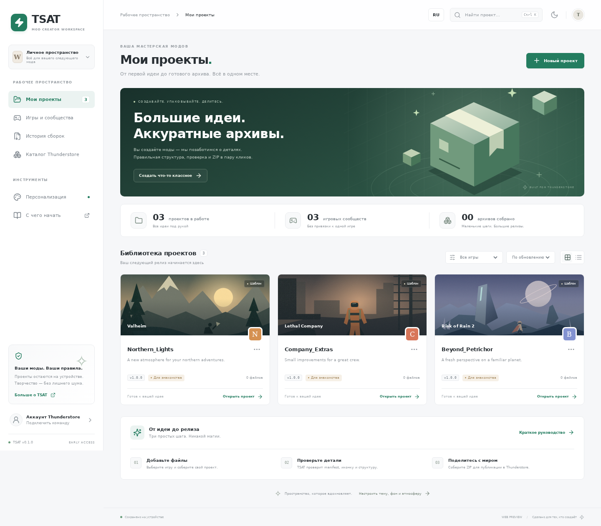

[English (primary)](../README.md) · **Русский**

> **Обновление 0.1.1:** английский — язык по умолчанию (сохранённый русский остаётся доступен). Удаление теперь есть на карточке и в редакторе. Вкладка «Описание» → «Ответить на вопросы» создаёт README/CHANGELOG, а «Настроить иконку» открывает студию изображения, текста, фона и рамки. Добавлена поддержка загрузки в Backblaze B2; реальные права и приём пакета проверяет Thunderstore.

<p align="center"></p>

<p align="center">
  <strong>Ваша мастерская модов. От идеи до аккуратного архива.</strong><br />
  Локальное рабочее пространство для авторов Thunderstore — без лишней рутины.
</p>

<p align="center">
  <a href="#-возможности">Возможности</a> ·
  <a href="#-быстрый-старт">Быстрый старт</a> ·
  <a href="#-windows-установщик-и-portable">Windows</a> ·
  <a href="SECURITY.md">Безопасность</a> ·
  <a href="https://github.com/ItzHanchik/ThunderStoreArchiveTool-TSAT-/issues">Обратная связь</a>
</p>

> **Early access · 0.1.1.** Рабочий MVP, не официальный клиент Thunderstore. Установщик и portable собираются в Windows CI; рабочий процесс дополнительно проверяет упакованный EXE, ZIP и DPAPI. Готовые артефакты доступны только у успешного прогона. API-публикация экспериментальная: реализована по контракту официального CLI, требует проверки с реальной командой. ZIP можно публиковать вручную через сайт.

## ✨ Возможности

| Меньше рутины | Больше вашего стиля |
| --- | --- |
| Библиотека проектов, поиск, фильтры, дублирование | Светлая и тёмная темы |
| Редактор manifest v1, README и changelog | Шесть акцентов и произвольный цвет |
| Markdown-предпросмотр без исполнения HTML | Собственный фон PNG / JPG / WebP |
| Файлы и папки с сохранением вложенной структуры | Снег, дождь или спокойный фон |
| Проверка метаданных, путей и PNG 256 × 256 | Комфортная и компактная плотность |
| Асинхронная сборка настоящего ZIP | Адаптивный интерфейс на русском и английском |
| Зависимости и локальный журнал экспортов | Клавиатурная навигация, поиск `Ctrl K` |
| Автосохранение проектов и файлов в IndexedDB | Поддержка системного reduced motion |

<p align="center"></p>

### Много игр. Один рабочий процесс.

Valheim, Lethal Company, Risk of Rain 2, Content Warning, BONEWORKS, BONELAB, ROUNDS, R.E.P.O. и другие. Нет вашей игры? Укажите идентификатор сообщества из `thunderstore.io/c/<community>/`.

TSAT использует общий формат **manifest v1**, но не утверждает, что у всех игр одинаковые загрузчики. Нужную структуру и зависимости выбирает автор. Встроенные иллюстрации оригинальные, не официальные обложки игр. Три первых проекта — **шаблоны без игровых DLL**, а не готовые моды.

## 🚀 Быстрый старт

Требуется **Node.js 22.12+** (рекомендуется актуальная версия 22) и npm.

```bash
npm ci
npm run dev
```

Откройте адрес, выведенный Vite. Веб-версия умеет редактировать проекты и скачивать ZIP, но **не принимает токены** и не публикует через API.

```bash
npm test          # проверки упаковки и контракта публикации
npm run build    # TypeScript + production-сборка
npm run preview  # production web preview
npm run desktop  # сборка UI и запуск Electron
```

Если окружение запрещает загрузку бинарника Electron, для разработки только веб-интерфейса:

```bash
# Linux / macOS
ELECTRON_SKIP_BINARY_DOWNLOAD=1 npm ci
```

### Первый пакет за несколько шагов

1. Создайте проект и выберите игру (включая BONEWORKS и BONELAB как разные сообщества).
2. Заполните manifest, описание и README. Замените автоматически созданную иконку своей, если нужно.
3. На вкладке **Файлы** выберите папку с содержимым будущего ZIP. Её внешнее имя отбрасывается, вложенные папки сохраняются.
4. Добавьте зависимости в формате `Author-Package-1.0.0`.
5. Откройте **Проверку**, исправьте ошибки и нажмите **Собрать ZIP**.
6. Опубликуйте архив через официальный сайт или экспериментальную desktop API-публикацию.

```text
My_Mod-1.0.0.zip
├── manifest.json
├── README.md
├── icon.png              # PNG, ровно 256 × 256
├── CHANGELOG.md          # если заполнен
└── BepInEx/              # пример, НЕ обязательная структура для каждой игры
    └── plugins/
        └── MyMod.dll
```

## 🌐 Язык и шаблон описания

Переключайте **RU / EN** в верхней панели или выберите язык в **Персонализации → Язык интерфейса**. Настройка сохраняется локально; переводятся интерфейс, подсказки, проверки и системные диалоги.

README и CHANGELOG новых проектов **всегда на английском**, независимо от языка приложения. [Полный README-шаблон](docs/MOD_README_TEMPLATE.md) содержит обзор, features, требования, установку через менеджер/вручную, настройки, совместимость, troubleshooting, поддержку, credits и лицензию. Подсказки явно требуют указать реально протестированные версии вместо выдуманных обещаний совместимости.

В редакторе **Описание → Вставить английский шаблон** можно заменить существующий документ, только подтвердив действие. Смена языка никогда не переводит и не перезаписывает авторский текст.

<details><summary>English interface preview</summary>


</details>

## 🔐 Подключение к Thunderstore

**Никакого выдуманного OAuth, перехвата cookies или ввода пароля в TSAT.**

1. Откройте Thunderstore из раздела аккаунта. Авторизация проходит в системном браузере.
2. На сайте: **Settings → Teams → ваша команда → Service accounts**.
3. Создайте отдельный service account для TSAT и скопируйте токен.
4. В настольном приложении сохраните токен и укажите namespace команды в проекте.
5. Публикация требует подтверждения в интерфейсе и отдельном системном диалоге.

Токен шифруется Electron `safeStorage` (**DPAPI на Windows**), не возвращается в renderer, не сохраняется в IndexedDB и не включается в ZIP. «Сохранён» не означает «права проверены». В каталоге можно отдельно проверить авторизацию и получить команды; право публиковать конкретную версию окончательно проверяется сервером. Без системного шифрования сохранение блокируется. Удаление токена из TSAT не отзывает его на сайте.

API-процесс: `initiate-upload → PUT частей → finish-upload → submission/submit`. Токен отправляется только API Thunderstore, не на серверы хранения частей. Редиректы запрещены. При обрыве связи во время финальной отправки сначала проверьте страницу пакета, не публикуйте повторно вслепую.

Ссылки на используемые контракты: [официальный CLI](https://github.com/thunderstore-io/thunderstore-cli/blob/master/ThunderstoreCLI/API/ApiHelper.cs), [модели публикации](https://github.com/thunderstore-io/thunderstore-cli/blob/master/ThunderstoreCLI/Models/PublishModels.cs), [правила manifest](https://github.com/thunderstore-io/Thunderstore/blob/master/django/thunderstore/repository/package_manifest.py).

## 🪟 Windows: установщик и portable

**Windows 10/11 x64** — целевая платформа первой версии.

На Windows:

```powershell
npm ci
npm run dist:win -- --publish never
```

Результат в `release/`:

- `TSAT-0.1.1-x64-nsis.exe` — установщик с выбором папки и ярлыком.
- `TSAT-0.1.1-x64-portable.exe` — запуск без установки.

Также подготовлен workflow **Windows installer and portable**: после появления workflow в репозитории запустите его через **Actions → Run workflow**, выбрав рабочую ветку. Он также запускается при push в рабочую ветку TSAT и push тега `v*`. Готовые EXE появятся в артефакте `TSAT-Windows-x64`, если сборка завершится успешно. Workflow может прикрепить проверенные файлы к заранее созданному draft-релизу только при точном совпадении SHA. Публикация самого релиза остаётся явным действием.

**Цифровой подписи пока нет**: Windows SmartScreen может предупреждать о неизвестном издателе. Не распространяйте сборку как проверенный стабильный релиз до ручного тестирования на Windows.

В установочной версии данные находятся в `%APPDATA%/TSAT` (точное имя зависит от Electron app name). Portable использует `TSAT-data` рядом с EXE; папка должна быть доступна для записи. Зашифрованный токен привязан к пользователю/устройству Windows: на другом ПК потребуется подключиться заново.

## 📦 Данные и ограничения MVP

- Проекты, файлы и настройки хранятся локально. Нет сервера TSAT, телеметрии или облачной синхронизации.
- Делайте резервные копии через ZIP. Для восстановления распакуйте ZIP и импортируйте папку в новый проект; команду и игру задайте отдельно.
- Очистка данных приложения/браузера удаляет библиотеку. Браузерное хранилище не заменяет резервные копии.
- Локальный лимит: **200 МБ и 2000 файлов** на проект. Архив строится в памяти; это не решение для многогигабайтных пакетов.
- При импорте игнорируются `.git`, `.env*`, `node_modules`, `.DS_Store`, `Thumbs.db`, `.pdb`, `.zip`, `.exe`. Это не полноценный сканер секретов — проверяйте содержимое самостоятельно.
- Корневые manifest, README, changelog и иконка импортируются в редактор. Повторные пути заменяются без учёта регистра.
- Дополнительные поля manifest (например, `installers`) пока не поддерживаются: импорт отклоняется, а не молча теряет настройки.
- Существование зависимостей, права команды, уникальность версии и модерацию проверяет сервер. Локальная зелёная проверка не гарантирует приём пакета.
- TSAT управляет **авторскими проектами**, а не установленными модами игры. Онлайн-каталог показывает публичные пакеты и число загрузок. Импортирует только метаданные в новый черновик: DLL, оригинальная иконка и README не скачиваются. Двусторонняя синхронизация пока не реализована.
- Внешние изображения в Markdown-предпросмотре отключены, HTML не исполняется.

## 🧩 Устройство проекта

```text
src/
  App.tsx              Библиотека, навигация, персонализация, аккаунт
  Editor.tsx           Файлы, метаданные, документы и публикация
  lib/package.ts       Валидация путей, manifest, иконки и ZIP
  lib/storage.ts       IndexedDB, иконки, экспорт
  lib/model.ts         Модель проекта и сообщества
  styles.css           Темы, адаптивная вёрстка, погода
electron/
  main.cjs             Изолированное окно, IPC, DPAPI, системные диалоги
  preload.cjs          Минимальный мост без Node.js в renderer
  publish.cjs          Контракт публикации Thunderstore
  catalog.cjs          Ограниченный read-only API каталога и проверки токена
public/art/            Оригинальные SVG-иллюстрации
tests/                 Автоматические проверки
.github/workflows/     CI и Windows-сборка
```

## 🗺️ Дальше

- [x] Библиотека, редактор, ZIP и локальные проверки
- [x] Светлая/тёмная тема, акценты, свой фон, снег/дождь
- [x] Electron shell, защищённый токен и код API-публикации
- [x] Конфигурация installer / portable и Windows workflow
- [x] Автоматический Windows smoke-test упакованного EXE, ZIP, DPAPI и сохранения RU/EN
- [ ] Ручное испытание установки/удаления, portable и живой публикации
- [x] Онлайн-каталог сообществ и пакетов, поиск и проверка токена
- [ ] Выбор категорий и зависимостей из каталога в редакторе
- [x] Создание локального черновика из метаданных опубликованного пакета
- [ ] Двусторонняя синхронизация пакетов команды
- [ ] Потоковая упаковка больших проектов, прогресс и отмена
- [x] Английская локализация интерфейса и английский шаблон README/CHANGELOG
- [ ] Подпись релизов и автообновления

## 🤝 Участие

Баги и идеи — в [Issues](https://github.com/ItzHanchik/ThunderStoreArchiveTool-TSAT-/issues). Приложите версию TSAT, ОС и шаги воспроизведения. **Не прикладывайте токены, cookies и приватные файлы.** Перед PR: `npm test && npm run build`.

[MIT](../LICENSE) · Made by **ItzHanchik** · Не аффилирован с Thunderstore или разработчиками игр.

### Проверки онлайн-функций

Каталог и проверка токена работают через ограниченные IPC-операции из EXE. Контракты проверены mock-тестами; доступ к живому Thunderstore из среды разработки ограничен, поэтому успешная реальная авторизация и публикация не заявляются. Поиск использует experimental frontend endpoint Thunderstore (помечен upstream как deprecated): при изменении API приложение сообщает ошибку, не подставляет вымышленные данные.
